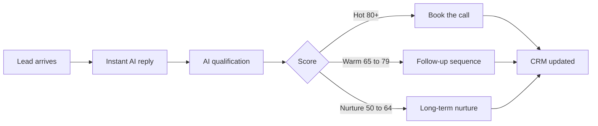

  <picture>
    <source media="(prefers-color-scheme: dark)" srcset="https://raw.githubusercontent.com/techaurah/techaurah/main/assets/banner.svg"/>
    <source media="(prefers-color-scheme: light)" srcset="https://raw.githubusercontent.com/techaurah/techaurah/main/assets/banner-light.svg"/>
    
  </picture>

  

  <a href="https://techaurah.com"><strong>Website</strong></a> ·
  <a href="https://techaurah.com/tools"><strong>Free Tools</strong></a> ·
  <a href="https://github.com/techaurah/ai-lead-automation"><strong>Flagship Project</strong></a> ·
  <a href="https://www.instagram.com/techaurah"><strong>Instagram</strong></a> ·
  <a href="https://www.facebook.com/profile.php?id=61594979312167"><strong>Facebook</strong></a> ·
  <a href="https://www.linkedin.com/company/techaurah/"><strong>LinkedIn</strong></a>

> [!TIP]
> **New here?** If your business runs on inquiries and follow-up, start with the free lead automation audit at [techaurah.com/tools](https://techaurah.com/tools). You keep the audit either way.

## At a glance

| | |
|---|---|
| **What** | An AI and software engineering company: AI products, agentic systems, and automation |
| **Who for** | Startups, SaaS, agencies, and service businesses that run on leads, bookings, and follow-up |
| **Where** | Based in Pakistan, working remotely with clients in the USA, UK, UAE, Canada, Australia, and Europe |
| **How to start** | One keyword on [Instagram](https://www.instagram.com/techaurah): AUTOMATE, BUILD, AGENT, INTEGRATE, FIX, or AUDIT |

| 💻 Software | 🧠 Intelligence | ⚡ Automation |
|---|---|---|
| Products, MVPs, APIs, and platforms, built properly | LLM features, agents, and RAG grounded in real business data | Workflows that capture, qualify, follow up, and book while you sleep |

## What we do

<table>
  <tr>
    <td width="50%" valign="top">
      <h3>🤖 Agentic AI</h3>
      AI agents that reason, use tools, remember context, and complete multi-step work inside your operations, with guardrails and human approval where it matters.
    </td>
    <td width="50%" valign="top">
      <h3>⚙️ AI Automation</h3>
      Lead handling, qualification, CRM updates, follow-up, reminders, and booking running as one system, not a pile of disconnected zaps.
    </td>
  </tr>
  <tr>
    <td width="50%" valign="top">
      <h3>🚀 AI Products and MVPs</h3>
      New AI products and features taken from idea to a working, testable release your customers can actually use.
    </td>
    <td width="50%" valign="top">
      <h3>🔌 AI Integration</h3>
      AI added into the product and tools you already run: your CRM, calendar, inbox, website, and internal systems.
    </td>
  </tr>
  <tr>
    <td width="50%" valign="top">
      <h3>🛠️ System Repair</h3>
      Broken agents, flaky automations, and AI features that disappoint in production, diagnosed at the root and rebuilt properly.
    </td>
    <td width="50%" valign="top">
      <h3>📈 Scale and Optimisation</h3>
      Working systems made faster, cheaper to run, and measurable, so growth does not break what already works.
    </td>
  </tr>
</table>

## Agentic AI, in depth

An agent is not a chatbot with a new name. It is an LLM given a goal, a set of tools, memory, and rules, then trusted to carry a real task to completion: reading an inquiry, checking the calendar, scoring the lead, writing the CRM, sending the follow-up, and booking the call.

### The models we build on

| Layer | What we work with |
|---|---|
| **Frontier LLMs** | GPT-class models (OpenAI), Claude (Anthropic), Gemini (Google) |
| **Open models** | Llama, Mistral, and other open-weight models where cost, privacy, or hosting control matters |
| **Embeddings and retrieval** | Vector search and RAG so agents answer from your data, not from guesses |

Model choice is an engineering decision, not a loyalty. We pick per task: capability, latency, cost, and data rules.

### How we build agents: code frameworks

| Framework | What it is best at in our work |
|---|---|
| **LangChain** | The standard toolkit for LLM applications: model calls, tools, retrievers, and chains that compose fast |
| **LangGraph** | Stateful agent graphs: multi-step agents with memory, branching, human-in-the-loop approval, and recovery when a step fails |
| **CrewAI** | Role-based multi-agent teams, where specialised agents hand work to each other |
| **Microsoft AutoGen** | Conversational multi-agent systems and agent collaboration patterns |
| **OpenAI Agents SDK** | Lightweight agents with tools, handoffs, and tracing on OpenAI models |
| **LlamaIndex** | Data-first agents and RAG: indexing, retrieval, and querying over business knowledge |
| **Semantic Kernel** | Enterprise .NET and Microsoft-stack agent integration |
| **MCP (Model Context Protocol)** | The open standard we use to connect agents to tools and data, including our own [LeadPipe MCP](https://github.com/techaurah/leadpipe-mcp) |

### How we build agents: no-code and low-code tools

Not every system needs custom code. When speed matters more than depth, we build on:

| Tool | Best for |
|---|---|
| **n8n** | Self-hostable workflow automation with AI nodes, our default automation backbone |
| **Make** | Visual, scenario-based automation across hundreds of apps |
| **Zapier** | The fastest path from a trigger to an action across mainstream SaaS |
| **Flowise and Langflow** | Visual, low-code builders for LangChain-style agents and chatflows |
| **Dify** | Low-code LLM app and agent workflows with built-in RAG |
| **Voiceflow** | No-code conversational and voice agent design |

**Our rule:** no-code to validate, code to scale. Many client systems start on n8n and graduate the hard parts to LangGraph or a custom MCP server when volume or logic demands it.

### Agent patterns we ship

Single agent with tools · Multi-agent teams · Human-in-the-loop approval · RAG-grounded agents · Planner and executor loops · Guardrails, evaluation, and fallback models on every production agent

## Automation, in depth

- [x] **Lead capture** from Instagram, WhatsApp, web forms, and email into one pipeline
- [x] **Instant AI replies** in under a minute, at 2pm or 2am
- [x] **AI qualification and scoring** against your criteria, not generic questions
- [x] **CRM write and update** on HubSpot, Pipedrive, GoHighLevel, or Google Sheets
- [x] **Follow-up sequences** that stop the moment a human replies
- [x] **Calendar booking** with availability checks and reminders
- [x] **Daily pipeline summaries** so nothing hot ever sits unseen

The full open blueprint, with architecture and prompts, is the featured project below.

## Featured project: AI Lead Automation

- [x] [Architecture and data model](https://github.com/techaurah/ai-lead-automation/blob/main/docs/architecture.md)
- [x] [Qualification prompt patterns](https://github.com/techaurah/ai-lead-automation/blob/main/docs/qualification-prompts.md)
- [x] [CRM field mapping: HubSpot, Pipedrive, GoHighLevel, Sheets](https://github.com/techaurah/ai-lead-automation/blob/main/docs/crm-field-mapping.md)
- [x] [Follow-up sequence patterns](https://github.com/techaurah/ai-lead-automation/blob/main/docs/follow-up-patterns.md)
- [x] MIT licensed: adapt it for your own business

**[Explore the repository](https://github.com/techaurah/ai-lead-automation)**

## Open-source portfolio

Five focused tools, each solving one problem completely, and one free course, all MIT licensed and open to contributions:

| Project | The problem it solves |
|---|---|
| **[Agentic AI for Beginners](https://github.com/techaurah/agentic-ai-for-beginners)** | Anyone learning to build agents has no free, complete course that runs from the first tool call to a tested, deployed business assistant |
| **[LeadPipe MCP](https://github.com/techaurah/leadpipe-mcp)** | Businesses with no CRM get a scored, bookable lead pipeline an AI assistant can safely operate, on Google Sheets and Calendar |
| **[n8n-audit](https://github.com/techaurah/n8n-audit)** | Production n8n workflows carry known failure classes (secrets, open webhooks, no error handling) that nobody checks automatically |
| **[QualBench](https://github.com/techaurah/qualbench)** | Agent changes ship untested against business outcomes: wrong stage, invalid booking, invented discount |
| **[ChaseKit](https://github.com/techaurah/chasekit)** | Earned money sits uncollected because invoice chasing is manual, and the tools are suites or closed SaaS |
| **[SlotFill](https://github.com/techaurah/slotfill)** | Cancelled and no-show slots sit empty while waitlisted clients are never asked |

### Learn with TechAurah Academy

TechAurah Academy is where we teach the work in the open. Start with [Agentic AI for Beginners](https://github.com/techaurah/agentic-ai-for-beginners), our free course of 36 lessons plus a capstone: the free way to learn how we design, build, test, and ship agents, in the same order we use with clients.

## Tech we work with

  

  
  
  
  
  
  
  
  
  
  
  

## How we work

| Step | What happens |
|---|---|
| **1. Discover** | We learn how your business actually runs: where leads, time, and money leak |
| **2. Diagnose** | A clear audit: the problem, the cost of leaving it, and the fix that matters most |
| **3. Design** | A scoped plan: what gets built, what it connects to, what it deliberately leaves out |
| **4. Build** | Working software in short cycles, tested against real cases from your business |
| **5. Launch and improve** | Deployed, monitored, and tuned. Systems get smarter, or they get replaced |

## Who we work with

Agencies · Real estate · Clinics and med spas · Dental · Law firms · Home services · Roofing and solar · Recruitment · Consulting and coaching · SaaS and B2B · Ecommerce · Startups and SMEs

## Building in public

Our open-source presence started in October 2026. Everything listed here links to something real.

| Date | What shipped |
|---|---|
| Oct 31, 2026 | [AI Lead Automation blueprint](https://github.com/techaurah/ai-lead-automation) published with full docs and MIT license |
| Oct 31, 2026 | First external contribution opened: LangWatch example for the n8n docs [OpenTelemetry tracing page](https://github.com/n8n-io/n8n-docs/issues/5597), in discussion with maintainers |
| Nov 1, 2026 | Five open-source projects published at v0.1.0, all with green CI: [LeadPipe MCP](https://github.com/techaurah/leadpipe-mcp), [n8n-audit](https://github.com/techaurah/n8n-audit), [QualBench](https://github.com/techaurah/qualbench), [ChaseKit](https://github.com/techaurah/chasekit), [SlotFill](https://github.com/techaurah/slotfill) |

**In progress:** v0.2 work across the portfolio (a SQLite store for LeadPipe MCP, more n8n-audit rules, new QualBench scenario packs, more ChaseKit jurisdictions, SlotFill calendar adapters), plus external contributions to the tools we build on.

## Community and support

| Channel | Best for |
|---|---|
| [GitHub Issues](https://github.com/techaurah/ai-lead-automation/issues) | Bugs, ideas, and questions about our open source |
| [Instagram @techaurah](https://www.instagram.com/techaurah) | Starting a project (send a keyword), quick questions |
| [techaurah.com](https://techaurah.com) | Project inquiries, the free audit, and free tools |
| [Facebook](https://www.facebook.com/profile.php?id=61594979312167) | Updates and community |

## Start a project

| Keyword | You get |
|---|---|
| **AUTOMATE** | A lead automation system for your business |
| **BUILD** | An AI product or MVP, scoped and engineered |
| **AGENT** | A custom AI agent for your operations |
| **INTEGRATE** | AI added into your existing tools and product |
| **FIX** | A broken automation or AI system diagnosed and repaired |
| **AUDIT** | A free audit of your current lead flow, with the leaks costed |

## Contributing

1. Open an issue first, with enough detail to reproduce the problem or evaluate the idea.
2. Agree the shape with us in the issue, then send a pull request.
3. Small, focused, and tested beats large and speculative, every time.

## Questions, answered

<strong>Code or no-code: which do you recommend?</strong>

Both, in sequence. No-code (n8n, Make, Zapier) validates a workflow in days. When volume, logic, or cost demands it, the hard parts graduate to code: LangChain, LangGraph, or a custom MCP server. We work in both worlds, so the advice is not biased by what we sell.

<strong>Which LLM should my business use?</strong>

It depends on the task: reasoning depth, speed, cost per call, and your data rules. We build model-agnostic systems, so you are never locked to one provider, and we recommend after seeing your actual use case, not before.

<strong>Is TechAurah a product company or an agency?</strong>

An engineering company. We build AI products and systems for clients, and we publish our own blueprints and tools as open source, starting with AI Lead Automation and LeadPipe MCP.

<strong>Where are you based, and who do you work with?</strong>

Based in Pakistan, working remotely with companies in the USA, UK, UAE, Canada, Australia, and Europe. Communication and delivery are fully online.

<strong>What does the free audit include?</strong>

A scored review of your lead flow: where inquiries arrive, how fast they get answered, how qualification and follow-up work, and what the leaks are costing. You keep the audit either way. Start at https://techaurah.com/tools

<strong>Do you open source client work?</strong>

Never client data or private systems. We publish patterns, blueprints, and tools that are ours to share, generalised so any business can learn from them.

  
  

<em>TechAurah: Software · Intelligence · Automation. Building intelligent systems that move businesses forward.</em>

