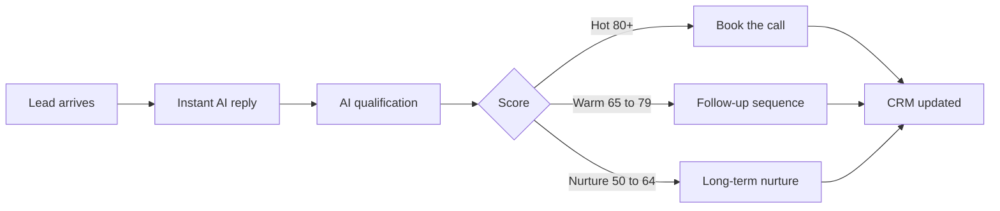

  

  
  
  
  

<strong>We build AI products, agents, and automation that turn manual work into systems.</strong> 
Startups, SaaS companies, agencies, and service businesses across the USA, UK, UAE, Canada, Australia, and Europe work with TechAurah to ship intelligent software, and to fix, integrate, and scale what they already have.

## Who we are

TechAurah is an AI and software engineering company. Everything we do sits on three pillars:

| 💻 Software | 🧠 Intelligence | ⚡ Automation |
|---|---|---|
| Products, MVPs, APIs, and platforms built properly | LLM features, agents, and RAG grounded in real business data | Workflows that capture, qualify, follow up, and book while you sleep |

Our rule for every project: understand the business problem first, then engineer the smallest system that solves it completely. No hype features, no technology for its own sake.

## What we build

| Area | What it means in practice | See it |
|---|---|---|
| **Agentic AI** | AI agents with tools, memory, and guardrails, working inside real operations | [AI Lead Automation](https://github.com/techaurah/ai-lead-automation) |
| **RAG systems** | Chat and search over your documents and knowledge, with grounded, cited answers | In the blueprint architecture |
| **MCP servers** | Model Context Protocol servers that connect AI to the tools a business already runs | LeadPipe MCP, in specification (below) |
| **AI automation** | Lead handling, qualification, CRM updates, follow-up, and booking on autopilot | [The full blueprint](https://github.com/techaurah/ai-lead-automation) |
| **AI integration** | Adding AI into existing products and workflows without a rebuild | [Talk to us](https://techaurah.com) |
| **System repair and scale** | Fixing broken automations and AI features, then making them fast and reliable | [Talk to us](https://techaurah.com) |

## Featured project: AI Lead Automation

Our open blueprint for the problem almost every service business has: inquiries arrive at all hours, replies go out late, follow-up depends on memory, and booked calls leak away.

**[Explore the repository](https://github.com/techaurah/ai-lead-automation)** · [Architecture](https://github.com/techaurah/ai-lead-automation/blob/main/docs/architecture.md) · [Qualification prompts](https://github.com/techaurah/ai-lead-automation/blob/main/docs/qualification-prompts.md) · [CRM field mapping](https://github.com/techaurah/ai-lead-automation/blob/main/docs/crm-field-mapping.md) · [Follow-up patterns](https://github.com/techaurah/ai-lead-automation/blob/main/docs/follow-up-patterns.md)

## Tech we work with

  
  
  
  
  
  
  
  
  
  
  
  

## How we work

| Step | What happens |
|---|---|
| **1. Discover** | We learn how your business actually runs: where leads, time, and money leak |
| **2. Diagnose** | You get a clear audit of the problem, the cost of leaving it, and the fix that matters most |
| **3. Design** | A scoped plan: what gets built, what it connects to, what it deliberately leaves out |
| **4. Build** | Working software in short cycles, tested against real cases from your business |
| **5. Launch and improve** | Deployed, monitored, and tuned. Systems get smarter, or they get replaced |

## Who we work with

Agencies · Real estate · Clinics and med spas · Dental · Law firms · Home services · Roofing and solar · Recruitment · Consulting and coaching · SaaS and B2B · Ecommerce · Startups and SMEs

If your business runs on inquiries, appointments, and follow-up, our systems are built for you.

## Building in public

Our open-source presence started in October 2026. This profile is where the work shows up as it ships, and everything listed here links to something real.

| Date | What shipped |
|---|---|
| Oct 31, 2026 | [AI Lead Automation blueprint](https://github.com/techaurah/ai-lead-automation) published with full docs and MIT license |
| Oct 31, 2026 | First external contribution opened: LangWatch example for the n8n docs [OpenTelemetry tracing page](https://github.com/n8n-io/n8n-docs/issues/5597), in discussion with maintainers |

**In progress now**

- **LeadPipe MCP**: an MCP server that gives small businesses without a CRM a scored, bookable lead pipeline on Google Sheets and Calendar. Currently in specification. It becomes a public repository when the first working version is ready, not before.
- More examples and workflow patterns for the AI Lead Automation blueprint.

## Start a project the fast way

Message us on [Instagram](https://www.instagram.com/techaurah) or through [techaurah.com](https://techaurah.com) with one keyword, and we will know exactly what you need:

| Keyword | You get |
|---|---|
| **AUTOMATE** | A lead automation system for your business |
| **BUILD** | An AI product or MVP, scoped and engineered |
| **AGENT** | A custom AI agent for your operations |
| **INTEGRATE** | AI added into your existing tools and product |
| **FIX** | A broken automation or AI system diagnosed and repaired |
| **AUDIT** | A free audit of your current lead flow, with the leaks costed |

## Contributing

Contributions are welcome, starting with documentation, examples, and n8n workflow patterns for AI Lead Automation.

1. Open an issue first, with enough detail to reproduce the problem or evaluate the idea.
2. Agree the shape with us in the issue, then send a pull request.
3. Small, focused, and tested beats large and speculative, every time.

## Questions, answered

<strong>Is TechAurah a product company or an agency?</strong>

An engineering company. We build AI products and systems for clients, and we publish our own blueprints and tools as open source, starting with AI Lead Automation and LeadPipe MCP.

<strong>Where are you based, and who do you work with?</strong>

We are based in Pakistan and work remotely with companies in the USA, UK, UAE, Canada, Australia, and Europe. Communication and delivery are fully online.

<strong>What does the free audit include?</strong>

A scored review of your lead flow: where inquiries arrive, how fast they get answered, how qualification and follow-up work, and what the leaks are costing. You keep the audit either way. Start at https://techaurah.com/tools

<strong>Do you open source client work?</strong>

Never client data or private systems. We publish patterns, blueprints, and tools that are ours to share, generalised so any business can learn from them.

<strong>How do we start working together?</strong>

Send one of the keywords above on Instagram, or reach us through techaurah.com. You will get a diagnosis before anyone talks about building.

  

<em>Building intelligent systems that move businesses forward.</em>

